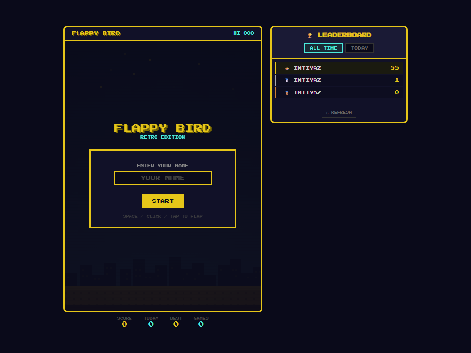
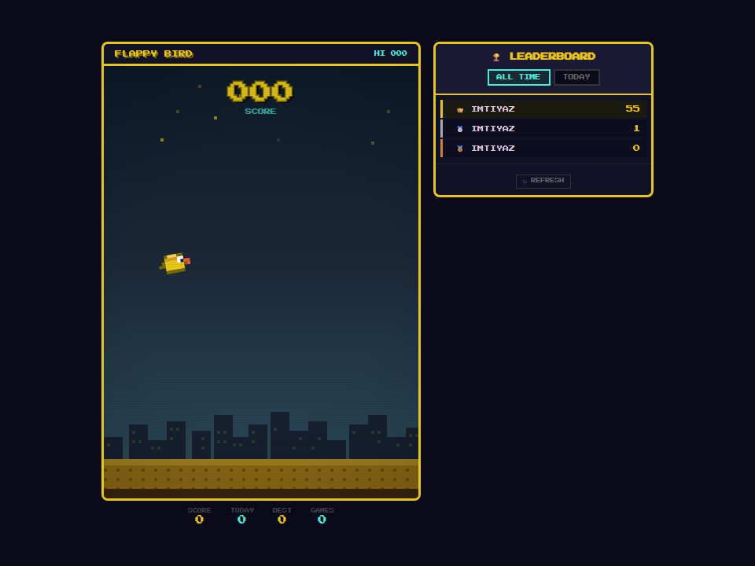
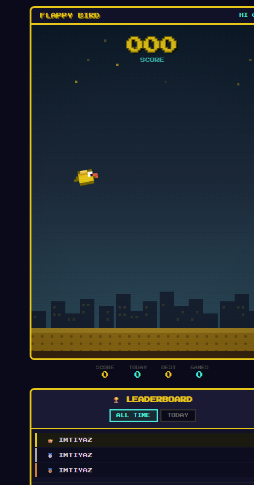

# 🐤 Retro Flappy Bird

A retro-styled **Flappy Bird** clone with a **global leaderboard** powered by **Firebase (Firestore + Cloud Functions)**. Built with pixel-art aesthetics, responsive UI, and smooth physics tuned for fair, fun gameplay.

🔗 **Live Demo:** https://flappy-2855b.web.app



## 🧾 Changes So Far

- Built the retro Flappy Bird frontend (HTML5 Canvas, pixel-art styling, smooth physics)
- Added initial Node/Express leaderboard backend (`server.js`) + Vercel config
- Migrated backend to **Firebase**:
  - Cloud Functions (Express API backed by Firestore)
  - Firestore security rules (public read, server-only writes)
  - Firebase Hosting with API rewrites
- Removed legacy Vercel server/JSON data store files
- Added responsive UI improvements and game-over stats/rank display
- Added project documentation and captured UI screenshots
- Fixed deployment/runtime issues and Node version configuration
- Deployed Firebase app to: **https://flappy-2855b.web.app**

## ✨ Features

- **Retro pixel-art visuals** — scanlines, vignette, animated city skyline & stars
- **Balanced physics** — forgiving hitbox, capped fall speed, smooth rotation
- **Global leaderboard** — all-time & today's top scores, persisted in Firestore
- **Player stats** — personal best (today / all-time), total games, global rank
- **Responsive** — adapts to mobile, tablet, and desktop
- **Anti-cheat friendly** — scores are validated server-side via Cloud Functions
- **Accessible interactions** — keyboard, mouse, and touch support

## 📸 Interface

### Main Menu / Game Over


### Mobile Layout


## 🧠 Tech Stack

| Layer | Tech |
|---|---|
| Frontend | Vanilla HTML5 Canvas + CSS (no build step) |
| Backend | Firebase Cloud Functions (Node.js 20, Express) |
| Database | Cloud Firestore |
| Hosting | Firebase Hosting |

## 📁 Project Structure

```
flappy-bird-retro/
├── .firebaserc
├── firebase.json
├── firestore.rules
├── docs/
│   └── screenshots/
├── functions/
│   ├── index.js          # Express API on Cloud Functions
│   └── package.json
└── public/
    └── index.html        # Game (UI + logic)
```

## 🚀 Getting Started

### Prerequisites
- [Firebase account](https://console.firebase.google.com/) & project
- [Node.js 20](https://nodejs.org/) (recommended) + npm
- [Firebase CLI](https://firebase.google.com/docs/cli)

### Firebase Setup
1. Create a Firebase project (e.g. `flappy-2855b`).
2. Enable **Firestore Database** (production mode).
3. Install CLI and log in:
   ```bash
   npm install -g firebase-tools
   firebase login
   ```
4. The project is pre-configured via `.firebaserc` — update it if your project ID differs.

### Local Dev (Emulators)
```bash
cd flappy-bird-retro
cd functions && npm install && cd ..
firebase emulators:start
# open http://localhost:5000
```
> The "Today" leaderboard query requires a Firestore composite index (`date` ASC + `score` DESC). The emulator/console will prompt you to create it on first request.

### Deploy to Production
```bash
cd flappy-bird-retro
cd functions && npm install && cd ..
firebase deploy
```
Your game will be live at `https://<project-id>.web.app`.

## 🎮 How to Play
- Press **Space**, **↑ Arrow**, **click**, or **tap** to flap.
- Avoid the pipes; each cleared pair scores 1 point.
- Enter your name on first run — your best scores are tracked on the global leaderboard.

## 📡 API (Cloud Functions)

| Method | Route | Description |
|---|---|---|
| `GET` | `/api/leaderboard` | Top 50 all-time scores |
| `GET` | `/api/leaderboard/today` | Top 50 scores for today |
| `POST` | `/api/leaderboard` | Submit `{ name, score }` |
| `GET` | `/api/leaderboard/player/:name` | Player stats (best today / all-time, games) |

## 🔒 Security Notes
- Direct Firestore writes are **denied** by `firestore.rules`.
- All score writes pass through the Cloud Function, which validates name/score ranges.
- Hosting rewrites `/api/**` → `api` function.

## 🛠️ Future Improvements
- [ ] Anonymous auth + App Check for stronger anti-cheat
- [ ] Realtime leaderboard updates via Firestore listeners
- [ ] Sound effects & difficulty tiers
- [ ] CI/CD for automated deploys

## 📄 License

MIT

---

Made with ❤️ and pixels.